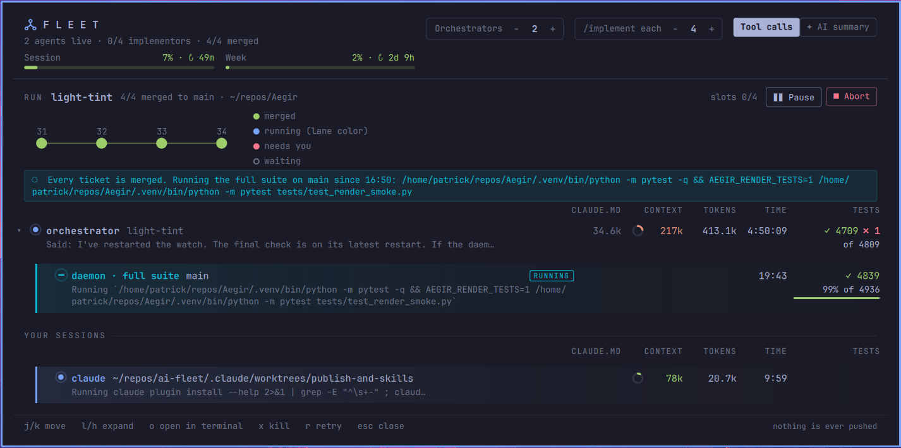

# ai-fleet

Runs `/implement` on many tickets at once and shows every Claude agent in an Omarchy bar panel.

- **daemon** (`fleet daemon`, systemd user service `ai-fleet`) schedules tickets onto Claude Code background
  sessions (`claude --bg -w <ticket>`), answers their hooks, merges finished work into the base branch, and
  writes `~/.local/state/ai-fleet/state.json` for the panel.
- **hooks** (`hooks/fleet-hook`) are attached only to sessions the fleet starts, via `--settings`:
  - `PreToolUse` on `AskUserQuestion` hands the question to the orchestrator, then to you, and returns the answer.
  - `Stop` runs the tests; red sends the implementor back to fix (up to `fix_rounds`), green queues the merge.
- **`fleet` CLI**: the orchestrator skill, the panel and you all use it. `fleet --help` lists the commands.
- **skill** `/implement-orchestrator` (in `skill/`) turns tickets into a plan and follows the run's events.
- **skills** for the How-to playbooks, also in `skill/` and global once installed: `/research-academic`, `/humanizer`,
  and the paper skills `/write-section`, `/make-figure`, `/make-table`, `/review-section` and `/find-papers`. The paper
  skills need a repo laid out for them (`paper/CONTEXT.md`, `make check`, `scripts/zotero.py`) and stop without one.
- **panel** (in `omarchy-plugin/`) is the Fleet dropdown in the Omarchy bar.

## Usage limit

The daemon reads your account's 5-hour and weekly usage from the statusline input that sessions report. The
header shows it. When the limit stops an agent, its row reads "Stopped by the usage limit · resets HH:MM",
no new tickets start, and a banner shows up. Once the limit resets, click **▶ Continue** in that banner (or
run `fleet continue`). This resumes every background session the limit stopped. Interactive sessions can't be
resumed this way, so type `continue` in their terminal.

## Inactive sessions

A `fleet cc` session keeps running after you close its terminal, which makes it easy to forget. Once one of
your sessions has sat idle for `inactive_after_min` (30), its row gets an orange **inactive 22h** pill, with
**· no terminal** when no `claude attach` is showing it. Nothing is stopped for you: right-click → Kill (or
`x`) when you're done with it.

## Phone pushes

`fleet phone` makes a long random [ntfy](https://ntfy.sh) topic (`ai-fleet-…`) the first time, saves it as
`ntfy_topic` in `limits.toml`, and tells you how to subscribe in the ntfy iOS app. `fleet phone --test` sends a
test push. `install.sh` runs `fleet phone` at the end. The topic is the only secret: anyone who knows it can read
the pushes. Clear `ntfy_topic` to turn pushes off. `ntfy_server` (default `https://ntfy.sh`) points at your own
server. A push that fails is logged to the journal and dropped.

Anything in the panel's "needs you" list (a question, a permission or sudo prompt, a failed merge, a held repo,
a stalled or failing fixer, a failed final check) that's still open `phone_delay_min` (2) minutes after it
showed up sends one high-priority push: who it is as the title, the message as the body. Handle it at the desk
within that window and the phone stays quiet. If the item clears and comes back, it counts as new. Run done,
all merged and usage-limit popups stay on the desktop.

## AI training

The panel's footer has the live tabs, **Agentic** and **AI-train** (`t` switches between them), and then,
set apart, your own **Todo** (`d`) and **How-to** (`?`). `install.sh` adds a short rule
(`skill/training-rule.md`) to `~/.claude/CLAUDE.md` telling every new Claude session to log to TensorBoard and
register what it launches:

    fleet train watch --host pc4090 --dir ~/runs/overnight --tensorboard ~/venv/bin/tensorboard --epochs 72 \
      --stop 'pkill -f "[o]utput-dir .*/{run}"' --train-loss Loss/total --map Test/coco_eval_bbox_0

The daemon starts one TensorBoard per watch on that machine, bound to localhost, reaches it through an `ssh -L`
tunnel, and reads it every 15s while the panel is open (60s otherwise). The daemon knows no framework: the agent
says which tags mean what, and every TensorBoard run under `--dir` becomes a row, so a queue's later runs appear
by themselves. A row is named after its path under `--dir`, so agents are told to give each run a meaningful name
before launching it. Training you start yourself isn't tracked.

A row shows the machine, status, epoch, ETA, mAP and a small loss curve. Click it for the curves, every other tag,
and per-class mAP if the run was registered with `--class-map` (the agent may run a small converter if the training
saves per-class results to disk but doesn't log them). Right-click a running or stalled run for **Stop**,
which runs its `--stop` command at once; the rest of a queue carries on. Right-click anything not running for
**Remove**, which clears it from ai-fleet and leaves the logs on the training machine. Removing a watch's last run
stops its TensorBoard, so a queue still between runs then needs registering again.

A run is **stalled** after no new data for 3 epochs of its recent speed (at least 2 minutes, or an hour before it has
two epochs to judge by). Crashes look the same. Training never raises "needs you" or sends a push. In the Agentic
tab, the agent that registered a watch only gets a **training** pill while one of its runs is going.

## Todo

One global list of todos in `~/.local/state/ai-fleet/todos.json`. A todo with a due time is a **reminder**:
when it comes due, the daemon pops one desktop notification that stays up until you dismiss it, and the Todo tab
shows a red count of overdue reminders. Nothing goes to your phone. A todo can link a Markdown file, which opens
rendered inside the panel (with **Open in editor** next to it).

In the tab, type in the fields at the top and press Enter. Click a todo to tick it off, right-click it to edit or
delete it, and **Clear done** removes every ticked one. Reminders sort first by due time, then the other todos,
then done ones, struck through. From a terminal:

    fleet todo add "check the eval run" --due "tomorrow 9:00" --md ~/notes/eval.md
    fleet todo ls
    fleet todo done 3        # also: undone, rm, edit 3 --due +2h / --no-due / --md … / --no-md, clear-done

Due times read `14:00` (today), `tomorrow 9:00`, `2026-11-12`, `2026-11-12 14:00`, `+30m`, `+2h` and `+3d`; a date
alone means 09:00. The CLI writes the file itself, so todos work while the daemon is down, but reminders only pop
up while it runs. `install.sh` adds a rule (`skill/todo-rule.md`) to `~/.claude/CLAUDE.md`, so asking any Claude
session to "remind me Friday to check the eval run" lands here too.

## How-to

Playbooks of which skill to use at each step, one Markdown file per sub-tab (`h`/`l` switch), drawn as a
flowchart: the stages of the main flow left to right, each stage's main path stacked in order with its optional
skills under it, and the skills for any time below. Point at a skill to see when to use it, and click it to copy it.
A skill that isn't installed is faded and marked ✕.

    ## 3. Build it                     <- a numbered section is a stage of the main flow
    - `/implement-orchestrator`: …     <- `-` is the main path, in order
    + `/tdd`: …                        <- `+` is optional or an alternative
    ## Any time                        <- an unnumbered section is a group for any time

The files live in `~/.config/ai-fleet/howto/`, which is seeded from the repo's `howto/` (software implementation and
scientific writing) the first time it's missing. After that the folder is yours: **Edit playbook** opens one, and any
other `.md` you drop in becomes a tab named after its first `# ` heading. One with no skill bullets shows as plain
Markdown.

## Merged and pushed

A finished run, and each of your own sessions that's in a git repo and not working right now, shows two ticks:
**merged** into the base branch (the remote's default branch for a session), and **pushed**, meaning every
commit is on a remote. Until it's pushed, the second tick is a button (or run `fleet push <path>`). It pushes
the base branch once the work is merged into it, otherwise the session's own branch. If the push fails, the
reason shows under the row: no remote yet, the remote repo doesn't exist, no write access, an unknown SSH host
key, a protected branch, the remote is ahead (pull first), or the network.

## Install

    ./install.sh            # links everything into place, every skill in skill/ included, and starts the daemon
    ./install.sh --remove   # undoes it; runs and settings are kept
    ./install-skills.sh     # installs Matt Pocock's skills plugin (provides /implement)

Code stays here. Settings: `~/.config/ai-fleet/limits.toml` (the panel edits it too).
State: `~/.local/state/ai-fleet/`. Socket: `$XDG_RUNTIME_DIR/ai-fleet.sock`.

## A plan

    {"repo": "~/code/ledger-api", "base": "main",
     "checks": {"test": "pnpm test", "quick": "pnpm tsc --noEmit && pnpm vitest run --changed", "full": "pnpm test"},
     "tickets": [{"id": "14", "title": "Refund webhook", "body": "...", "blockedBy": ["12"],
                  "implement_command": "/write-section"}]}

`test` runs in the ticket's worktree when the implementor stops. `quick` runs on the base branch after each
merge. `full` runs once when every ticket is merged. A ticket's `implement_command` starts its implementor
instead of the global one in `limits.toml`; leave it out to use the global one. `fleet status` and the
ticket's tooltip in the panel show it when it differs from the global one.

## Working on the panel

The shell's hot reload doesn't pick up edits to a symlinked plugin reliably (it keeps serving the old
compiled QML). After changing anything in `omarchy-plugin/`, run `omarchy restart shell`.

## Tests

    python3 -m unittest discover -s tests

To try the daemon without touching the real one, set `AI_FLEET_STATE`, `AI_FLEET_CONFIG` and `AI_FLEET_SOCK`.
