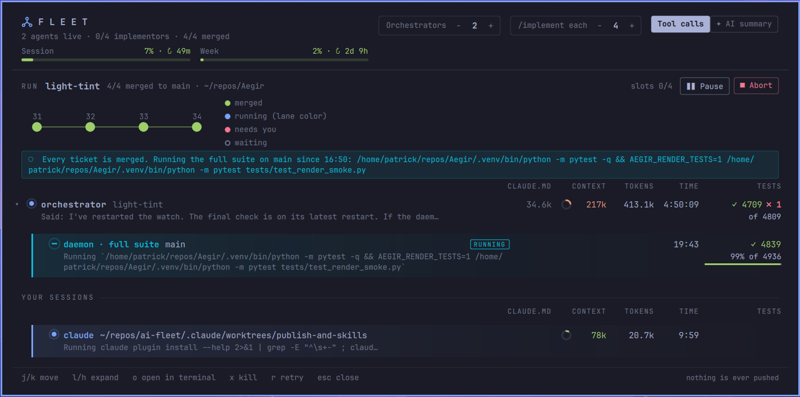

# ai-fleet

Runs `/implement` on many tickets at once and shows every Claude agent in an Omarchy bar panel.

- **daemon** (`fleet daemon`, systemd user service `ai-fleet`) schedules tickets onto Claude Code background
  sessions (`claude --bg -w <ticket>`), answers their hooks, merges finished work into the base branch, and
  writes `~/.local/state/ai-fleet/state.json` for the panel.
- **hooks** (`hooks/fleet-hook`) are attached only to sessions the fleet starts, via `--settings`:
  - `PreToolUse` on `AskUserQuestion` hands the question to the orchestrator, then to you, and returns the answer.
  - `Stop` runs the tests; red sends the implementor back to fix (up to `fix_rounds`), green queues the merge.
- **`fleet` CLI**: the orchestrator skill, the panel and you all use it. `fleet --help` lists the commands.
- **skill** `/implement-orchestrator` (in `skill/`) turns tickets into a plan and follows the run's events.
- **panel** (in `omarchy-plugin/`) is the Fleet dropdown in the Omarchy bar.

## Usage limit

The daemon reads your account's 5-hour and weekly usage from the statusline input that sessions report. The
header shows it. When the limit stops an agent, its row reads "Stopped by the usage limit · resets HH:MM",
no new tickets start, and a banner shows up. Once the limit resets, click **▶ Continue** in that banner (or
run `fleet continue`). This resumes every background session the limit stopped. Interactive sessions can't be
resumed this way, so type `continue` in their terminal.

## Inactive sessions

A `fleet cc` session keeps running after you close its terminal, which makes it easy to forget. Once one of
your sessions has sat idle for `inactive_after_min` (30), its row gets an orange **inactive 22h** pill, with
**· no terminal** when no `claude attach` is showing it. Nothing is stopped for you: right-click → Kill (or
`x`) when you're done with it.

## Phone pushes

`fleet phone` makes a long random [ntfy](https://ntfy.sh) topic (`ai-fleet-…`) the first time, saves it as
`ntfy_topic` in `limits.toml`, and tells you how to subscribe in the ntfy iOS app. `fleet phone --test` sends a
test push. `install.sh` runs `fleet phone` at the end. The topic is the only secret: anyone who knows it can read
the pushes. Clear `ntfy_topic` to turn pushes off. `ntfy_server` (default `https://ntfy.sh`) points at your own
server. A push that fails is logged to the journal and dropped.

## Merged and pushed

A finished run, and each of your own sessions that's in a git repo and not working right now, shows two ticks:
**merged** into the base branch (the remote's default branch for a session), and **pushed**, meaning every
commit is on a remote. Until it's pushed, the second tick is a button (or run `fleet push <path>`). It pushes
the base branch once the work is merged into it, otherwise the session's own branch. If the push fails, the
reason shows under the row: no remote yet, the remote repo doesn't exist, no write access, an unknown SSH host
key, a protected branch, the remote is ahead (pull first), or the network.

## Install

    ./install.sh            # links everything into place and starts the daemon
    ./install.sh --remove   # undoes it; runs and settings are kept
    ./install-skills.sh     # installs Matt Pocock's skills plugin (provides /implement)

Code stays here. Settings: `~/.config/ai-fleet/limits.toml` (the panel edits it too).
State: `~/.local/state/ai-fleet/`. Socket: `$XDG_RUNTIME_DIR/ai-fleet.sock`.

## A plan

    {"repo": "~/code/ledger-api", "base": "main",
     "checks": {"test": "pnpm test", "quick": "pnpm tsc --noEmit && pnpm vitest run --changed", "full": "pnpm test"},
     "tickets": [{"id": "14", "title": "Refund webhook", "body": "...", "blockedBy": ["12"]}]}

`test` runs in the ticket's worktree when the implementor stops. `quick` runs on the base branch after each
merge. `full` runs once when every ticket is merged.

## Working on the panel

The shell's hot reload doesn't pick up edits to a symlinked plugin reliably (it keeps serving the old
compiled QML). After changing anything in `omarchy-plugin/`, run `omarchy restart shell`.

## Tests

    python3 -m unittest discover -s tests

To try the daemon without touching the real one, set `AI_FLEET_STATE`, `AI_FLEET_CONFIG` and `AI_FLEET_SOCK`.
